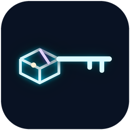

<p align="center">
  
</p>

# NeonPlan own pack keys

Home Assistant custom integration that registers **your own Ed25519 public keys**
in [NeonPlan 3D](https://github.com/Mastershort/neonplan3d), so furniture packs
you sign yourself (with `tools/fp3dpack.py` from the neonplan3d repository) can
be imported — without patching `packs.py`, which every NeonPlan update would
overwrite.

## Install via Marketplace

1. Marketplace → **Add repository** → paste
   `https://github.com/mohnen/neonplan-own`, type **Integration**
2. Install **NeonPlan own pack keys**
3. Restart Home Assistant
4. Settings → Devices & services → **Add integration** → "NeonPlan own pack keys"

Requires NeonPlan 3D to be installed. A new entry is seeded with the default
key in `const.py` (`DEFAULT_KEYS`) — delete it via Configure if you don't need it.

## Managing keys

Settings → Devices & services → NeonPlan own pack keys → **Configure**:

- **Add a public key** — paste the key ID and base64 public key printed by
  `python tools/fp3dpack.py keygen keyfile.pem`
- **Generate a new signing key** — creates an Ed25519 keypair, registers the
  public key and saves the private key to
  `config/neonplan_ownkeys/<key_id>.pem`
- **Update a key** — replace the public key of an existing key ID
- **Delete keys** — remove keys; changes apply immediately, no restart needed

## Furniture packs

`packs/` contains two self-signed furniture packs with official
dimensions:

- **IKEA** (`ikea.fp3dpack`, 45 items) — Klippan, Kallax, Billy, Malm,
  Pax, Lack, Bestå and more
- **JYSK** (`jysk.fp3dpack`, 19 items) — Falslev, Vejlby, Kalby,
  Tylstrup, Vedde, Jenslev, Haldager and more

Each `.fp3dpack` is ready to import (NeonPlan → Editor → Möbel →
Möbel-Pack importieren). The `.json` files are generated sources (don't
edit by hand); the `gen_*_pack.py` scripts rebuild them — add items to
`ITEMS`, then rebuild + re-sign:

```bash
python packs/gen_jysk_pack.py   # writes packs/jysk.json
uv run --with cryptography --with voluptuous tools/fp3dpack.py sign \
  packs/jysk.json --key pack-signing-key.pem
```

The signing key is **not** part of this repository. Its public key
(`e43284d2e58f`) is seeded as the default key in `const.py`, so the packs
import out of the box once this integration is set up. Pushes to
`packs/gen_*.py` are rebuilt and re-signed automatically by the
[sign-pack workflow](.github/workflows/sign-pack.yml) (key stored as the
`PACK_SIGNING_KEY` repository secret).
